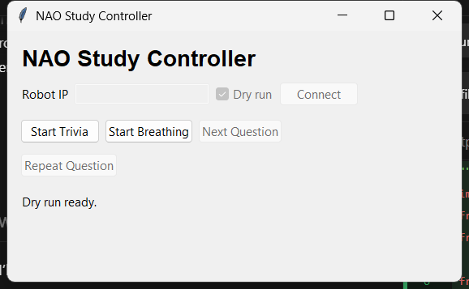

# Say It to My Face — NAO controller

This standalone Python GUI runs the robot interaction for the KU EECS 690 study [Say It to My Face](https://github.com/lntegrals/say-it-to-my-face). An operator advances a practice question and eight fixed trivia rounds. NAO deliberately answers rounds 4, 7, and 8 incorrectly in both conditions. A separate button starts or stops silent arm breathing during evaluation.

## Run the controller

1. On a computer with Python 3 and Tkinter, download `nao_gui.py`. Launch it with `python3 nao_gui.py`.
2. To rehearse without NAO, leave **Dry run** checked and click **Connect**. To run with NAO, use a Python environment with the `qi` package installed and a computer that can reach the robot on port 9559. Prepare NAO in a supported, awake posture and disable Autonomous Life using the lab procedure. Enter the IP, uncheck **Dry run**, and click **Connect**.
3. Click **Start Trivia**. After each reply or pass, click **Reveal Answer**, then **Next Question**. Use **Repeat Question** if requested.
4. For **Robot Present**, click **Start Breathing** during the survey transition and check the idle motion before starting the survey. Click **Stop Breathing** at the end of evaluation. For **Robot Absent**, remove NAO according to the study protocol and leave breathing off.

The full GUI flow has passed in dry-run mode. Verify speech, visibility of seated breathing, and stopping behavior on the assigned robot before collecting data.

## Robot demonstration video

**Video pending.** The team will add an embedded recording of NAO running the trivia interaction and the silent breathing mode here.

## Generative AI use

OpenAI Codex assisted with implementing and testing the controller and preparing its documentation.
